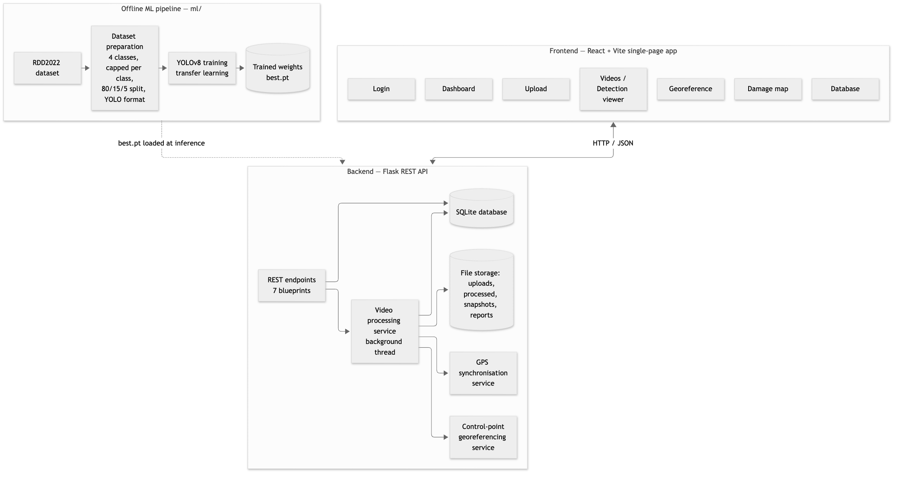
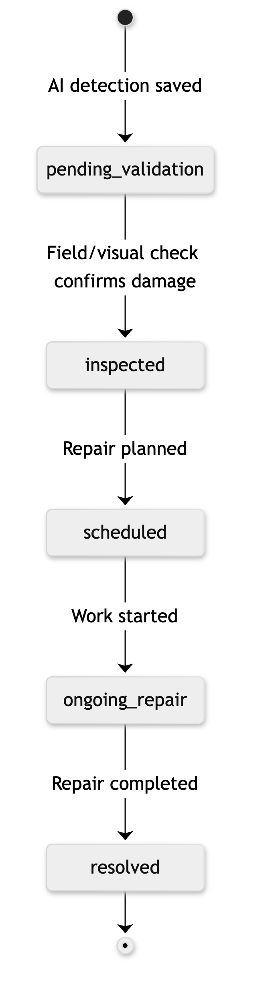
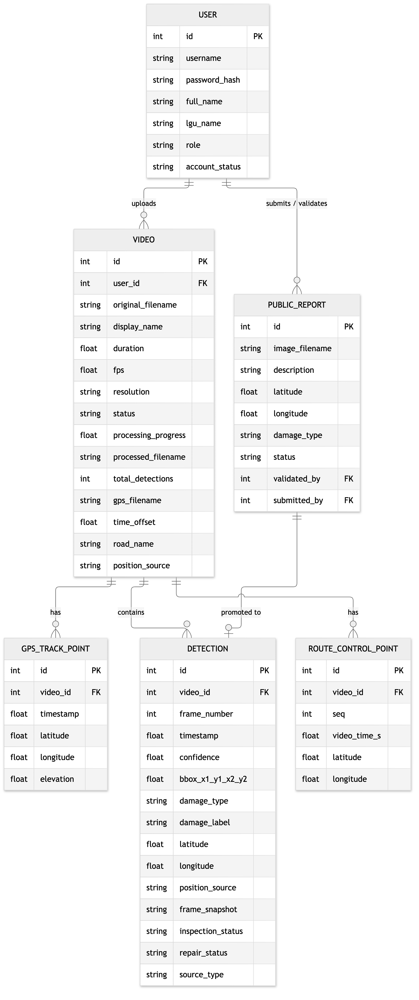

# Chapter 3 — System Overview: Bantay Kalsada

> Draft system overview for Chapter 3 (Methodology), written from the current codebase. Section
> numbers are suggestions; renumber them to fit the chapter. The notes for the authors at the end
> are not part of the chapter text.

---

## 3.1 System Overview

**Bantay Kalsada** is a web-based road damage detection and monitoring system built for Philippine
Local Government Units (LGUs). The partner office is the Local Government Unit of Mendez-Nuñez,
Cavite. The system takes road survey videos recorded from a moving vehicle and detects road surface
damage with a YOLOv8 object detection model. Each detection is assigned a geographic position, and
the results are shown in a role-based web application where LGU personnel can review the footage,
see damage on a map, and track the inspection and repair status of each damage record.

The system detects the four damage classes of the Crowdsensing-based Road Damage Detection Challenge
(CRDDC 2022), using the RDD2022 dataset's own class codes (Arya et al., 2022):

| Code | Damage class        | Description                                  |
|------|---------------------|----------------------------------------------|
| D00  | Longitudinal crack  | Crack running parallel to the road direction |
| D10  | Transverse crack    | Crack running across the road direction      |
| D20  | Alligator crack     | Interconnected cracking forming a mesh       |
| D40  | Pothole             | Bowl-shaped depression in the road surface   |

RDD2022 has no D30 class, so the numbering skips from D20 to D40.

### 3.1.1 Objectives addressed by the system

1. **Automated detection.** Detect and classify road damage in survey video with no manual frame
   review.
2. **Geolocation.** Place every detection on a map, either from a GPS track recorded during the
   survey or from reference points placed by hand when no GPS log exists.
3. **Record keeping.** Store every detection with its evidence (an annotated frame snapshot),
   confidence score, damage class, location, and workflow status in one database.
4. **Monitoring and reporting.** Give LGU users a dashboard, a searchable damage database, CSV/JSON
   export, and a damage map for planning inspection and repair.

### 3.1.2 Scope of the system

- **Input:** road survey videos in MP4, AVI, MOV, MKV or WebM format, up to 10 minutes long and
  500 MB in size, with an optional GPS track in GPX or CSV format.
- **Output:** an annotated video with bounding boxes, one database record per unique damage
  instance, frame snapshots, map visualisation, and exportable data.
- **Out of scope:** severity scoring. An earlier design scored severity as a weighted sum of damage
  type, bounding-box area, damage clustering and confidence
  (`0.4×damageType + 0.3×bboxArea + 0.2×cluster + 0.1×confidence`). It was removed from the product
  and is kept as future work (Sec 3.1.6). The system records damage class and position only.

---

## 3.2 System Architecture

The system has three independent parts: a machine-learning training pipeline that runs offline, a
backend API server, and a web client.



*Figure 3.1. System architecture of Bantay Kalsada*

### 3.2.1 Three-tier structure

| Tier                 | Technology                                             | Responsibility                                                                  |
|----------------------|--------------------------------------------------------|---------------------------------------------------------------------------------|
| Presentation         | React 19, React Router 7, Vite, Leaflet / React-Leaflet, Axios | User interface, role-based navigation, video playback, map rendering           |
| Application          | Python, Flask 3.1, Flask-CORS, Ultralytics YOLOv8, OpenCV, gpxpy, FFmpeg | REST API, video inference, GPS synchronisation, georeferencing, data export |
| Data                 | SQLite via Flask-SQLAlchemy; local file system         | Persistent records; uploaded, processed and snapshot files                     |

### 3.2.2 Development tools and environment

| Category              | Tools                                                                  |
|-----------------------|------------------------------------------------------------------------|
| Programming languages | Python 3, JavaScript (JSX)                                             |
| Deep learning         | PyTorch, Ultralytics YOLOv8                                            |
| Computer vision       | OpenCV (frame decoding, drawing, video writing)                        |
| Video encoding        | FFmpeg (H.264 re-encoding for browser playback)                        |
| Web framework         | Flask (backend), React + Vite (frontend)                               |
| Mapping               | Leaflet with OpenStreetMap tiles                                       |
| Database              | SQLite                                                                 |
| Training environment  | Local GPU (8 GB VRAM) or Google Colab / Kaggle (T4 GPU)                |

---

## 3.3 Machine Learning Component

### 3.3.1 Dataset

The model is trained on **RDD2022** (Road Damage Dataset 2022), the dataset of the CRDDC 2022
challenge. It contains road images from several countries annotated in Pascal VOC XML format. The
preparation scripts (`ml/download_rdd2022.py`, `ml/dataset_prep.py`) do the following:

1. **Class filtering.** Keep only annotations for D00, D10, D20 and D40 and drop all other RDD2022
   labels.
2. **Class balancing.** Keep at most 2,500 images per class (configurable). An image counts toward
   every class it contains, so the rarer classes are not crowded out by the common ones.
3. **Format conversion.** Convert each VOC bounding box to YOLO format
   (normalised centre x, centre y, width, height), clamped to the range [0, 1].
4. **Splitting.** Divide the images into **80% training, 15% validation and 5% test**.
5. **Configuration.** Write a `data.yaml` with four classes in a fixed index order:

| Index | Class name          | RDD2022 code |
|-------|---------------------|--------------|
| 0     | longitudinal_crack  | D00          |
| 1     | transverse_crack    | D10          |
| 2     | alligator_crack     | D20          |
| 3     | pothole             | D40          |

The backend relies on this index order when a model's class names do not include a damage code
(Sec 3.4.3).

### 3.3.2 Model selection

**YOLOv8** (You Only Look Once, version 8; Ultralytics) was chosen because it is a single-stage
detector that runs fast enough for video, has an anchor-free detection head, and supports transfer
learning from COCO-pretrained weights. The main model is **YOLOv8m** (medium). **YOLOv8s** (small)
is an ablation that trades some accuracy for speed.

### 3.3.3 Training configuration

Training uses transfer learning: the model starts from COCO-pretrained weights and is fine-tuned on
the prepared four-class dataset (`ml/train_model.py`).

| Hyperparameter          | Value                                  |
|-------------------------|----------------------------------------|
| Base model              | YOLOv8m (COCO-pretrained)              |
| Maximum epochs          | 100                                    |
| Early stopping patience | 20 epochs without validation mAP gain  |
| Batch size              | 16                                     |
| Input image size        | 640 × 640                              |
| Optimiser               | AdamW                                  |
| Initial learning rate   | 0.001 (final LR factor 0.01)           |
| Momentum / weight decay | 0.937 / 0.0005                         |
| Warm-up                 | 3 epochs (warm-up momentum 0.8)        |

**Data augmentation:**

| Augmentation            | Setting                              |
|-------------------------|--------------------------------------|
| HSV jitter (H / S / V)  | 0.015 / 0.7 / 0.4                    |
| Rotation                | ±10°                                 |
| Translation / scale     | 0.1 / 0.5                            |
| Shear / perspective     | 2.0 / 0.0001                         |
| Vertical / horizontal flip | 0.5 / 0.5                         |
| Mosaic                  | 1.0                                  |
| MixUp                   | 0.15                                 |

An alternative local configuration (`ml/train_local.py`) for an 8 GB GPU uses YOLOv8m, 150 epochs,
an image size of 1024 and a batch size of 4. The larger input size helps with thin cracks.

The acceptance target set before training is **mAP@50 ≥ 0.50** on the local validation set.

### 3.3.4 Evaluation metrics

The trained model is evaluated on the held-out split (`ml/evaluate_model.py`) with the standard
object detection metrics:

- **Precision** — P = TP / (TP + FP)
- **Recall** — R = TP / (TP + FN)
- **F1-score** — F1 = 2PR / (P + R)
- **mAP@50** — mean Average Precision at an IoU threshold of 0.50
- **mAP@50–95** — mAP averaged over IoU thresholds from 0.50 to 0.95 in steps of 0.05
- **Per-class AP@50** — reported separately for D00, D10, D20 and D40

System throughput is measured from the per-video export (`GET /api/videos/export`). For each video
it reports the total frames, the frames actually run through the model, and the wall-clock
processing time (Sec 3.4.6).

---

## 3.4 Detection and Processing Pipeline

### 3.4.1 Upload and validation

When a user uploads a video (and optionally a GPS track, a time offset and a road name):

1. The file extension is checked (video: mp4/avi/mov/mkv/webm; GPS: gpx/csv). The file is saved
   under a random UUID name.
2. OpenCV reads the metadata: FPS, frame count, resolution and duration (frame count ÷ FPS).
3. Videos longer than **600 seconds (10 minutes)** are deleted and rejected before any processing
   starts.
4. A `Video` record is created with status `uploaded`, and processing starts in a background thread
   so the user gets a response right away.

### 3.4.2 Frame sampling and inference

Running the model on every frame is unnecessary, because consecutive frames at 30 fps are nearly
identical. The system samples frames at a fixed analysis rate instead:

| Parameter       | Value | Meaning                                              |
|-----------------|-------|------------------------------------------------------|
| `INFERENCE_FPS` | 5     | Frames analysed per second of video                  |
| `CONF_THRESHOLD`| 0.15  | Minimum confidence for a prediction to be kept       |
| `IOU_THRESHOLD` | 0.45  | Overlap threshold for non-maximum suppression        |

Every *n*-th frame is analysed, where *n* = max(1, ⌊FPS / INFERENCE_FPS⌋). For a 30 fps video,
*n* = 6. The low confidence threshold favours recall: in a monitoring setting a missed pothole is
worse than a false alarm, and false alarms are filtered out during human validation (Sec 3.6).

So that the annotated output video does not flicker, the boxes from each inference frame are drawn
again on the following frames for 0.5 seconds (FPS × 0.5 frames).

### 3.4.3 Damage classification

Each predicted class is mapped to an RDD2022 code in three steps:

1. **By name.** If the class name contains a known keyword (`d00`, `longitudinal`, `d10`,
   `transverse`, `lateral`, `d20`, `alligator`, `crocodile`, `d40`, `pothole`), it takes that code.
2. **By index.** For a custom model with up to five classes, the class index is read in the
   `data.yaml` order (0 → D00, 1 → D10, 2 → D20, 3 → D40). A single-class model is treated as
   pothole (D40).
3. **Rejection.** Classes that do not match one of the four CRDDC codes (for example a generic
   "crack" or "manhole" class) are dropped. They are not relabelled as potholes, so the system only
   reports the four classes it claims to detect.

### 3.4.4 Duplicate suppression

A single pothole stays in view for several seconds as the vehicle approaches it and is detected on
many sampled frames. To store one record per physical damage instead of one per frame, each
detection gets a de-duplication key:

```
key = ( ⌊x₁ / 100⌋, ⌊y₁ / 100⌋, ⌊frame_number / (2 × FPS)⌋ )
```

In words, the frame is divided into a 100-pixel grid and time into 2-second windows. Only the first
detection whose top-left corner falls in a given grid cell within a given window is saved.

### 3.4.5 Evidence and output generation

For every unique detection the system:

- Saves a **frame snapshot** (JPEG) with the bounding box, class label and confidence drawn on it.
- Writes a `Detection` record with its frame number, timestamp, confidence, bounding box, damage
  code and label, coordinates (if available), position source, road name, and an initial
  inspection status of `pending_validation`.

Every frame, annotated or not, is written to an output video. OpenCV first writes a Motion-JPEG AVI,
which is fast. FFmpeg then re-encodes it to **H.264 MP4** (CRF 18) so it plays in web browsers.
Processing progress (0–100%) is saved every 30 frames, and the frontend polls it to show a
progress bar.

### 3.4.6 Pipeline algorithm

```
Algorithm 1: Video Damage Detection Pipeline
Input:  video V, model M, optional GPS track G, optional control points C, time offset δ
Output: annotated video V', set of detections D

1   n ← max(1, ⌊fps / INFERENCE_FPS⌋)
2   seen ← ∅ ; D ← ∅
3   for each frame f_k in V (k = 1, 2, …):
4       if k mod 30 = 0: save progress k / total_frames
5       if k mod n = 0:
6           B ← M(f_k, conf = 0.15, iou = 0.45)
7           for each box b in B:
8               (code, label) ← classify(b.class)
9               if code is not one of D00/D10/D20/D40: continue
10              key ← (⌊b.x1/100⌋, ⌊b.y1/100⌋, ⌊k / (2·fps)⌋)
11              if key ∈ seen: continue
12              seen ← seen ∪ {key}
13              t ← k / fps                                   ▷ Formula 18
14              if G exists:      (lat, lon) ← interpolate_gps(G, t + δ)   ▷ Formula 19
15              else if |C| ≥ 2:  (lat, lon) ← interpolate_cp(C, t)       ▷ Formula 19 over C
16              else:             (lat, lon) ← (null, null)
17              save snapshot; D ← D ∪ {(k, t, b, code, lat, lon)}
18      draw active boxes on f_k; write f_k to V'
19  re-encode V' to H.264 MP4
20  return V', D
```

---

## 3.5 Geolocation of Detections

Each detection is given coordinates in one of two ways. The `position_source` field on both `Video`
and `Detection` records which one was used: `gps_file`, `georeferenced`, or `none`.

### 3.5.1 GPS–video timestamp synchronisation

If a GPS track is uploaded with the video, it is parsed (GPX through `gpxpy`; CSV with
auto-detected delimiter and column names such as `lat`/`latitude`, `lon`/`lng`/`longitude`,
`time`/`timestamp`). The timestamps are normalised to seconds from the first point, and every point
is stored as a `GpsTrackPoint`.

The video time of a detection is:

**Formula 18:**  t_frame = frame_number / FPS

The user supplies a **time offset δ** (in seconds) to line up the start of the track with the start
of the video, so the matching GPS time is t = t_frame + δ. The coordinate is found by linear
interpolation between the two track points t_i and t_{i+1} on either side of t:

**Formula 19:**  G(t) = G_i + ((t − t_i) / (t_{i+1} − t_i)) × (G_{i+1} − G_i)

This is applied separately to latitude and longitude (and to elevation when present). Coordinates
are rounded to 7 decimal places, about 1 cm. A time before the start of the track or after its end
takes the first or last track point.

### 3.5.2 Control-point georeferencing (no GPS track)

Many existing survey videos were recorded without a GPS log. For these, the user opens the
**Georeference** page, scrubs through the video, and at recognisable landmarks such as
intersections, bridges or buildings clicks the matching spot on the map. Each click creates a
**control point** that pairs a video time with a map coordinate.

Each detection is then positioned by **piecewise-linear interpolation** between the two control
points on either side of its timestamp. This is Formula 19 applied to the control points instead of
a GPS track. Piecewise interpolation is needed because vehicle speed changes: the vehicle stops at
lights and slows in traffic. Spreading detections evenly along the route by total duration would
place them hundreds of metres off.

Validation rules:

- At least **two** control points.
- Video times must be strictly increasing and must fall within the video's duration.
- Coordinates must lie inside the Philippines (latitude 4.5°–21.5° N, longitude 116°–127° E).

Unlike GPS interpolation, a detection outside the range between the first and last control point is
**not** clamped. It is left without coordinates, because a made-up position is worse than none.
Saving or deleting control points re-positions all of that video's detections straight away, with
no need to run inference again.

### 3.5.3 Route display

For each survey the map shows one route: the full GPS track for a GPS-positioned survey, or the
straight segments joining the control points for a georeferenced one. Start and end are labelled on
each route.

---

## 3.6 Workflow and Human Validation

The AI detections feed a maintenance workflow. Each `Detection` has an **inspection status** that
LGU users update from the Database page:



*Figure 3.2. Inspection and repair workflow of a damage record*

A free-text **repair status** can also be recorded.

**Citizen reports.** The backend also accepts public road damage reports (photo, description, GPS
or typed location, damage class). An LGU user can validate or reject a report. A validated report
is promoted into a `Detection` record with `source_type = public_report`, so the database and map
hold both AI detections and validated citizen reports. This is available in the API only; there is
no web interface for it yet.

---

## 3.7 Database Design

The system uses a relational SQLite database managed through SQLAlchemy.



*Figure 3.3. Entity-relationship diagram*

| Table                  | Purpose                                                                  |
|------------------------|--------------------------------------------------------------------------|
| `users`                | LGU accounts with role and office (`lgu_name`); passwords stored as salted hashes |
| `videos`               | One row per survey: metadata, processing state, GPS settings, positioning method |
| `detections`           | The central record: AI output (box, confidence, class) plus location and workflow state |
| `gps_track_points`     | Parsed GPS track for a survey, in seconds from track start               |
| `route_control_points` | User-placed (video time → coordinate) pairs for surveys without GPS      |
| `public_reports`       | Citizen-submitted reports awaiting validation                            |

**Video lifecycle:** `uploaded` → `processing` → `completed` | `failed`.

---

## 3.8 User Roles and Access

The system follows the Philippine local government hierarchy:

| Role         | Dashboard | Upload | Videos | Map | Database |
|--------------|:---------:|:------:|:------:|:---:|:--------:|
| Barangay     | ✓         | ✓      | ✓      | ✓   |          |
| Municipal    | ✓         | ✓      | ✓      | ✓   | ✓        |
| Provincial   | ✓         | ✓      | ✓      | ✓   | ✓        |
| Administrator| ✓         | ✓      | ✓      | ✓   | ✓        |

Accounts are created by the administrator; there is no public self-registration screen. A user with
an unrecognised role gets the most restrictive (Barangay) access. Users see and manage the surveys
they uploaded, while the map and database show damage records across all surveys.

---

## 3.9 System Modules (User Interface)

| Module                 | Function                                                                                       |
|------------------------|------------------------------------------------------------------------------------------------|
| **Login**              | Username and password authentication                                                           |
| **Dashboard**          | Totals for surveys, detections and geolocated detections; counts by damage class and inspection status; recent surveys and detections |
| **Upload**             | Upload a survey video with an optional GPS track, time offset and road name                    |
| **Videos**             | List of surveys with processing progress; rename or delete a survey                            |
| **Detection Viewer**   | Plays the annotated video beside a list of detections; clicking a detection jumps to its timestamp and shows its snapshot |
| **Georeference**       | Places control points on a map while scrubbing a survey that has no GPS log                    |
| **Damage Map**         | OpenStreetMap base map with one route per survey and one colour-coded dot per detection by damage class |
| **Database**           | Searchable, filterable, sortable, paginated table of all damage records; inspection status updates; CSV/JSON export |

---

## 3.10 API Summary

The backend exposes a REST API under `/api`, grouped into seven blueprints:

| Area            | Prefix             | Main endpoints                                                                                |
|-----------------|--------------------|-----------------------------------------------------------------------------------------------|
| Authentication  | `/api/auth`        | `POST /login`, `GET /me`, `POST /logout`                                                      |
| Videos          | `/api/videos`      | `POST /upload`, `GET /`, `GET/PATCH/DELETE /:id`, `GET /:id/stream`, `GET /:id/processed`, `GET /:id/snapshot/:file`, `GET/POST /:id/control-points`, `DELETE /:id/control-points/:cp`, `GET /export` |
| Detections      | `/api`             | `GET /detections/:video_id`, `GET /dashboard/stats`                                           |
| Map             | `/api/map`         | `GET /videos`, `GET /detections`, `GET /gps-tracks`, `GET /stats`                             |
| Database        | `/api/database`    | `GET /detections`, `PUT /detections/:id/status`, `GET /export`, `GET /stats`                  |
| Public reports  | `/api/reports`     | `POST /`, `GET /`, `GET /:id`, `PUT /:id/validate`, `PUT /:id/reject`, `GET /image/:file`     |
| Accounts        | `/api/accounts`    | Administrator account management                                                              |

---

## 3.11 System Limitations

1. **Single-server processing.** Videos are processed in a background thread inside the web server
   process, not a job queue. Processing stops if the server restarts; interrupted surveys are
   marked `failed` at the next start-up and must be uploaded again.
2. **Video length.** Uploads are limited to 10 minutes and 500 MB so processing time stays
   predictable on modest hardware.
3. **Geolocation accuracy depends on the input.** GPS positioning is only as good as the phone or
   logger GPS and the time offset the user enters. Control-point positioning assumes constant speed
   between two neighbouring control points.
4. **Duplicate suppression is approximate.** The grid-and-window rule can still produce more than
   one record for a long crack that spans several grid cells, and can merge two separate damages
   that sit close together.
5. **Authentication.** Session handling is simplified for the prototype and is not
   production-grade. Role restrictions are enforced mainly in the user interface. A deployment
   would need signed, expiring tokens and server-side authorisation checks.
6. **No severity assessment.** Damage is classified by type only. Severity scoring is future work.
7. **Browser playback requires FFmpeg.** Without FFmpeg on the server, the annotated video stays as
   an AVI file that most browsers cannot play.

---

## Notes for the authors (not for the chapter)

- **Model in use.** `backend/app.py` currently loads `ml/models/rdd2022_pretrained.pt`, an external
  MIT-licensed RDD2022 YOLOv8n baseline marked there as a demo placeholder. It is not your model and
  its numbers must not appear in Chapter 4. The repo's own `ml/models/best.pt` is still
  single-class (pothole only). Section 3.3 describes the intended four-class YOLOv8m fine-tune;
  check it against the run you actually report.
- **Section cross-references.** The code comments cite Sec 3.1.6 (severity future work), Sec 3.2.1
  (training defaults), Sec 3.4 (inference settings / 10-minute cap), Formula 18, Formula 19 and
  Algorithm 1. Keep these numbers in step with the final chapter numbering.
- **Limitation 5** is worded for a thesis audience. In the code, the bearer token is simply the user
  ID and only the accounts routes check the role on the server.
- **Figures.** Figures 3.1–3.3 are in [figures/](figures/), each as a high-resolution PNG (for
  Word: Insert → Pictures) and an SVG (sharper when scaled; Word 365 accepts it too). The `.mmd`
  file next to each is its Mermaid source. To regenerate after an edit:
  `npx @mermaid-js/mermaid-cli -i figures/<name>.mmd -o figures/<name>.png -s 3 -b white -t neutral`.
