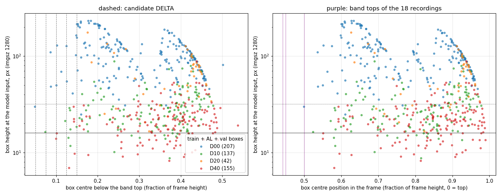

# Near zone: proposal

## Summary (2026-11-10 11:40)

- No reviewed box lies close to the horizon: every box but 2 is at least 0.10 of the frame height below
  the band top. A near-zone top of band top + 0.10 removes 0 val, 0 test and 31 of 419 train boxes, and
  makes the crops 20% shorter (fewer pixels where only false alarms can happen).
- It does not remove the small boxes. Damage lies flat on the road, so it is foreshortened: D40 and D10
  boxes are 10-40 px tall at the model input (imgsz 1280) even at the bottom of the frame, nearest the
  camera. Small boxes come from foreshortening, not distance; the remedy is resolution (imgsz 1920 = the
  crops' own 1920 px, boxes 1.5x taller) or a small-object (P2) head, not a narrower band.
- R05 (val): the dashboard reflection is a stripe at about 0.85-0.90 of the frame height over the right
  half of the picture, with the road and its damage still visible through it (also in R10 and R11, same
  car). A bottom above it (0.84) would remove 87 of R05's 96 boxes = 87 of the 122 val boxes (D40 37 of
  52): the nearest, largest damage. Recommendation: keep R05 at 1.00.
- R13/R14 (train): bottom 0.73 removes the bonnet strip; no labels are lost there.

Rule: **near-zone top = band top + DELTA** (band top = the horizon line, `road_top`), bottom = band bottom except R05 (dashboard reflection) and R13/R14 (bonnet). A box is lost when its centre falls outside. DELTA is chosen on train + AL + val boxes; test is only counted.

## Box size vs position

Median box height at the model input (imgsz 1280), by distance below the band top (train + AL + val):

| Below band top | Boxes | D00 | D10 | D20 | D40 | Median height px | Under 16 px | Under 32 px |
|---|---|---|---|---|---|---|---|---|
| 0.000-0.050 | 1 | 1 | 0 | 0 | 0 | 30 | 0 | 1 |
| 0.050-0.075 | 1 | 0 | 1 | 0 | 0 | 16 | 0 | 1 |
| 0.075-0.100 | 3 | 2 | 0 | 0 | 1 | 48 | 1 | 1 |
| 0.100-0.125 | 6 | 4 | 1 | 0 | 1 | 59 | 1 | 2 |
| 0.125-0.150 | 17 | 6 | 6 | 0 | 5 | 28 | 4 | 11 |
| 0.150-0.200 | 41 | 21 | 11 | 2 | 7 | 56 | 1 | 15 |
| 0.200-0.300 | 113 | 62 | 23 | 6 | 22 | 59 | 8 | 40 |
| 0.300-1.000 | 359 | 111 | 95 | 34 | 119 | 36 | 37 | 169 |

## Boxes lost per DELTA (with the new bottoms)

| DELTA | Split | Kept | Lost | D00 lost | D10 lost | D20 lost | D40 lost | Kept boxes under 32 px |
|---|---|---|---|---|---|---|---|---|
| 0.000 | train | 393 | 26 | 9/177 | 10/114 | 2/25 | 5/103 | 162 |
| 0.000 | val | 122 | 0 | 0/30 | 0/23 | 0/17 | 0/52 | 69 |
| 0.000 | test | 99 | 0 | 0/36 | 0/8 | 0/34 | 0/21 | 38 |
| 0.050 | train | 392 | 27 | 10/177 | 10/114 | 2/25 | 5/103 | 161 |
| 0.050 | val | 122 | 0 | 0/30 | 0/23 | 0/17 | 0/52 | 69 |
| 0.050 | test | 99 | 0 | 0/36 | 0/8 | 0/34 | 0/21 | 38 |
| 0.075 | train | 391 | 28 | 10/177 | 11/114 | 2/25 | 5/103 | 160 |
| 0.075 | val | 122 | 0 | 0/30 | 0/23 | 0/17 | 0/52 | 69 |
| 0.075 | test | 99 | 0 | 0/36 | 0/8 | 0/34 | 0/21 | 38 |
| 0.100 | train | 388 | 31 | 12/177 | 11/114 | 2/25 | 6/103 | 159 |
| 0.100 | val | 122 | 0 | 0/30 | 0/23 | 0/17 | 0/52 | 69 |
| 0.100 | test | 99 | 0 | 0/36 | 0/8 | 0/34 | 0/21 | 38 |
| 0.125 | train | 382 | 37 | 16/177 | 12/114 | 2/25 | 7/103 | 157 |
| 0.125 | val | 122 | 0 | 0/30 | 0/23 | 0/17 | 0/52 | 69 |
| 0.125 | test | 99 | 0 | 0/36 | 0/8 | 0/34 | 0/21 | 38 |
| 0.150 | train | 365 | 54 | 22/177 | 18/114 | 2/25 | 12/103 | 146 |
| 0.150 | val | 122 | 0 | 0/30 | 0/23 | 0/17 | 0/52 | 69 |
| 0.150 | test | 99 | 0 | 0/36 | 0/8 | 0/34 | 0/21 | 38 |

## Band tops and bottoms per recording (current -> proposed with DELTA 0.10)

| Recording | Split | Band now | Near zone (DELTA 0.10) | Crop height now -> new (px) | Note |
|---|---|---|---|---|---|
| R04 | train | 0.50-1.00 | 0.60-1.00 | 540 -> 432 |  |
| R05 | val | 0.50-1.00 | 0.60-1.00 | 540 -> 432 |  |
| R06 | test | 0.50-1.00 | 0.60-1.00 | 540 -> 432 |  |
| R07 | val | 0.50-1.00 | 0.60-1.00 | 540 -> 432 |  |
| R08 | train | 0.50-1.00 | 0.60-1.00 | 540 -> 432 |  |
| R09 | train | 0.50-1.00 | 0.60-1.00 | 540 -> 432 |  |
| R10 | train | 0.50-1.00 | 0.60-1.00 | 540 -> 432 |  |
| R11 | train | 0.50-1.00 | 0.60-1.00 | 540 -> 432 |  |
| R12 | train | 0.50-1.00 | 0.60-1.00 | 540 -> 432 |  |
| R13 | train | 0.45-0.80 | 0.55-0.73 | 378 -> 194 | bonnet from about 0.74 |
| R14 | train | 0.45-0.80 | 0.55-0.73 | 378 -> 194 | bonnet from about 0.74 |
| R15 | train | 0.44-0.87 | 0.54-0.87 | 465 -> 357 |  |
| R16 | val | 0.44-0.87 | 0.54-0.87 | 465 -> 357 |  |
| R17 | train | 0.44-0.87 | 0.54-0.87 | 465 -> 357 |  |
| R18 | train | 0.44-0.87 | 0.54-0.87 | 465 -> 357 |  |
| R19 | test | 0.44-0.87 | 0.54-0.87 | 465 -> 357 |  |
| R20 | train | 0.44-1.00 | 0.54-1.00 | 603 -> 495 |  |
| R21 | test | 0.44-1.00 | 0.54-1.00 | 603 -> 495 |  |

Mean image of every recording (fixed things stay: reflection, bonnet), orange = near-zone top at DELTA 0.10, red = proposed new bottom: `results/near_zone_means.jpg`.
